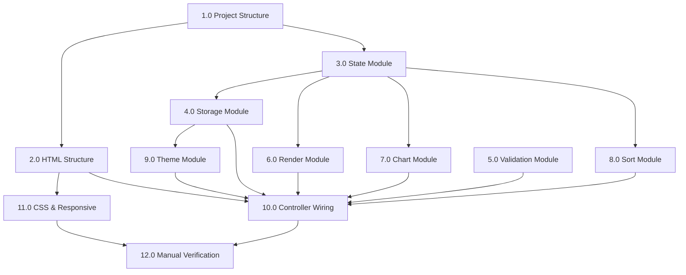

# Implementation Plan: Expense & Budget Visualizer

## Overview

This implementation plan breaks the Expense & Budget Visualizer into 12 ordered task groups, covering project setup, HTML structure, the eight JavaScript modules, CSS styling and responsive layout, and final manual verification. The plan follows the design document's module breakdown and implements each requirement and correctness property. Tasks are ordered so that foundational pieces (project structure, state, storage, validation) come before the modules that depend on them (rendering, chart, controller wiring).

## Tasks

- [x] 1.0 Set up project structure
  - [x] 1.1 Create `index.html` at the project root with semantic HTML5 boilerplate, viewport meta tag, and links to `css/style.css` and `js/app.js`
  - [x] 1.2 Create `css/style.css` with an empty base (placeholder for theme variables and layout)
  - [x] 1.3 Create `js/app.js` with a module structure scaffold (State, Storage, Validation, Render, Chart, Sort, Theme, Controller sections as comments or objects)
  - [x] 1.4 Verify the app loads without console errors when opening `index.html` in a browser
  - Refs: Folder Rules

- [x] 2.0 Build the HTML structure
  - [x] 2.1 Add a Header region containing a Balance display element and a theme toggle button
  - [x] 2.2 Add a Form Section with input fields for name (text), amount (number), category (select), a submit button, and a custom-category input with an add button
  - [x] 2.3 Add a Sort Controls region with a select for sort option (by amount, by category) and a default "none" option
  - [x] 2.4 Add a Transaction List Section with a scrollable container (`ul` element) for rendered transactions
  - [x] 2.5 Add a Chart Section with a container element for the SVG Pie_Chart
  - [x] 2.6 Add a validation message area near the form for displaying errors
  - Refs: Requirements 1.1, 3.1, 4.1, 8.1, 9.1

- [x] 3.0 Implement the State Module
  - [x] 3.1 Define in-memory state holding `transactions` (array), `categories` (array initialized with `["Food", "Transport", "Fun"]`), and `theme` (string defaulting to `"light"`)
  - [x] 3.2 Provide accessors to read and mutate state (get transactions, add transaction, delete transaction by id, get categories, add category, get/set theme)
  - [x] 3.3 Ensure every state mutation triggers persistence and re-render through the Controller (wire this once the Controller exists)
  - Refs: Requirements 1.2, 4.2, 7.2, 9.2, Data Models

- [x] 4.0 Implement the Storage Module
  - [x] 4.1 Implement `loadState()` that reads `ev_transactions`, `ev_categories`, and `ev_theme` from Local Storage, parses JSON, and returns state with defaults on missing or malformed data
  - [x] 4.2 Implement `saveTransactions()` that serializes the transactions array to `ev_transactions`
  - [x] 4.3 Implement `saveCategories()` that serializes the categories array to `ev_categories`
  - [x] 4.4 Implement `saveTheme()` that writes the theme string to `ev_theme`
  - [x] 4.5 Wrap `JSON.parse` in error handling that falls back to defaults on failure
  - Refs: Requirements 1.3, 4.3, 7.3, 9.3, 9.4, 10.1, 10.2, Design/Storage Module, Property 8

- [x] 5.0 Implement the Validation Module
  - [x] 5.1 Implement `validateTransaction(name, amount, category)` as a pure function that rejects when name is empty, amount is empty or not a positive number, or category is not selected
  - [x] 5.2 Implement `validateCategory(name, existingCategories)` as a pure function that rejects when name is empty or duplicates an existing category (case-insensitive)
  - [x] 5.3 Return a validation result containing a pass/fail flag and a descriptive message
  - Refs: Requirements 2.1, 2.2, 7.4, Properties 6, 7, Design/Validation Module

- [x] 6.0 Implement the Render Module
  - [x] 6.1 Implement `renderBalance()` that computes the sum of all transaction amounts and updates the Balance display element
  - [x] 6.2 Implement `renderList()` that rebuilds the Transaction_List from the transactions array, creating one list item per transaction showing name, amount, and category, each with a delete control
  - [x] 6.3 Implement `renderCategories()` that rebuilds the category select options from the categories array
  - [x] 6.4 Ensure each render function is idempotent (same state produces same output) and replaces the relevant DOM region
  - Refs: Requirements 3.1, 3.2, 4.1, 5.1, 5.2, 5.3, 7.2, Properties 1, 9, Design/Render Module

- [x] 7.0 Implement the Chart Module
  - [x] 7.1 Implement `aggregateByCategory(transactions)` as a pure function returning a map of category to the sum of amounts for transactions in that category
  - [x] 7.2 Implement `renderChart()` that calls `aggregateByCategory`, computes each slice angle from the category total relative to the grand total, and draws inline SVG path arcs into the chart container
  - [x] 7.3 Assign category colors from a fixed palette
  - [x] 7.4 Handle the empty state: when there are no transactions, render a placeholder instead of dividing by zero
  - [x] 7.5 Clear and redraw the SVG on each update
  - Refs: Requirements 6.1, 6.2, 6.3, 6.4, Properties 2, 3, 10, Design/Chart Module

- [x] 8.0 Implement the Sort Module
  - [x] 8.1 Implement `sortTransactions(transactions, option)` as a pure function returning a new sorted array; option is `"amount"` (ascending) or `"category"` (alphabetical)
  - [x] 8.2 Ensure the function does not mutate the input array
  - Refs: Requirements 8.1, 8.2, 8.3, 8.4, Properties 4, 5, Design/Sort Module

- [x] 9.0 Implement the Theme Module
  - [x] 9.1 Implement `applyTheme(theme)` that sets the `data-theme` attribute on the root `<html>` element and persists the theme
  - [x] 9.2 Implement `toggleTheme()` that switches between `"dark"` and `"light"`
  - Refs: Requirements 9.2, 9.3, 9.4, Design/Theme Module

- [x] 10.0 Implement the Controller / Event Wiring
  - [x] 10.1 On `DOMContentLoaded`, load state from Local Storage via `loadState()`, apply the stored theme, and render the balance, list, categories, and chart
  - [x] 10.2 Wire the form submit event: validate the transaction, add it to state on success, persist, and re-render; display a validation message on failure without mutating state
  - [x] 10.3 Wire the custom-category add button: validate the category, add it to state on success, persist, and re-render categories; display a validation message on failure
  - [x] 10.4 Wire the transaction delete control: remove the transaction from state, persist, and re-render
  - [x] 10.5 Wire the sort select change event: sort transactions by the selected option and re-render the list; when "none" is selected, restore the original order
  - [x] 10.6 Wire the theme toggle button: toggle the theme, persist, and apply
  - Refs: Requirements 1.2, 1.3, 2.1, 2.2, 4.2, 4.3, 7.2, 7.3, 7.4, 8.2, 9.2, 9.3, 10.1, 10.2, Design/Controller

- [x] 11.0 Implement the CSS styling and responsive layout
  - [x] 11.1 Define CSS custom properties (variables) for the light and dark theme palettes under `:root`/`[data-theme="light"]` and `[data-theme="dark"]`
  - [x] 11.2 Apply a clean, minimal visual style with clear hierarchy and readable typography using the theme variables
  - [x] 11.3 Build a Flexbox single-column layout that stacks header, form, sort controls, list, and chart vertically
  - [x] 11.4 Make the Transaction_List scrollable using `overflow-y: auto` with a max height
  - [x] 11.5 Scale the SVG chart container to available width using a relative `viewBox`
  - [x] 11.6 Add a media query for `max-width: 480px` adjusting font sizes, padding, and chart width so all controls and content fit with no horizontal scrolling
  - Refs: Requirements 11.1, 11.2, NFR-1, NFR-2, NFR-3, Design/Responsive Design, Design/Theme Implementation

- [x] 12.0 Manual verification
  - [x] 12.1 Verify adding a valid transaction updates the list, balance, and chart
  - [x] 12.2 Verify submitting with an empty field or non-positive amount shows a validation message and does not add the transaction
  - [x] 12.3 Verify deleting a transaction removes it from the list and updates the balance, chart, and Local Storage
  - [x] 12.4 Verify reloading the page restores all transactions, custom categories, and the theme from Local Storage
  - [x] 12.5 Verify adding a custom category makes it available in the form and persists across reloads
  - [x] 12.6 Verify adding an empty or duplicate category is rejected with a validation message
  - [x] 12.7 Verify sorting by amount and by category reorders the list while preserving all entries, and re-sorting produces the same order
  - [x] 12.8 Verify the theme toggle switches between dark and light and persists across reloads
  - [x] 12.9 Verify the layout has no horizontal scrolling at a 480px viewport width
  - [x] 12.10 Verify the app loads without console errors in Chrome, Firefox, Edge, and Safari
  - Refs: All Requirements, All Properties

## Task Dependency Graph

```json
{
  "waves": [
    {
      "wave": 1,
      "tasks": ["1.0"],
      "dependencies": []
    },
    {
      "wave": 2,
      "tasks": ["2.0", "3.0", "5.0"],
      "dependencies": ["1.0"]
    },
    {
      "wave": 3,
      "tasks": ["4.0", "8.0", "11.0"],
      "dependencies": ["3.0", "2.0"]
    },
    {
      "wave": 4,
      "tasks": ["6.0", "7.0", "9.0"],
      "dependencies": ["3.0", "4.0", "2.0"]
    },
    {
      "wave": 5,
      "tasks": ["10.0"],
      "dependencies": ["2.0", "3.0", "4.0", "5.0", "6.0", "7.0", "8.0", "9.0"]
    },
    {
      "wave": 6,
      "tasks": ["12.0"],
      "dependencies": ["10.0", "11.0"]
    }
  ]
}
```



Dependency notes:
- 1.0 (project structure) must complete first; everything else depends on the files existing.
- 2.0 (HTML structure) provides the DOM elements that 6.0 (Render), 10.0 (Controller), and 11.0 (CSS) target.
- 3.0 (State) is the data backbone consumed by 4.0, 6.0, 7.0, and 8.0.
- 5.0 (Validation) is a pure module with no internal dependencies; it is consumed by 10.0.
- 9.0 (Theme) depends on 4.0 (Storage) for persistence and on the HTML root element from 2.0.
- 10.0 (Controller) integrates all modules; it depends on 2.0 through 9.0.
- 11.0 (CSS) depends on 2.0 (HTML structure) and can proceed in parallel with the JS modules.
- 12.0 (verification) runs last and depends on all other tasks.

## Notes

- There is no test framework and no build step (NFR-1). Verification in task 12.0 is manual.
- The chart uses inline SVG drawn in vanilla JavaScript to remain self-contained for browser-extension use (Design/Chart Implementation).
- Theme switching uses a single `data-theme` attribute on `<html>` plus CSS custom properties, so no per-element JavaScript styling is needed.
- All persisted data is client-side only via the Local Storage API; there is no backend (TC-2).
- Keep code clean and readable with exactly one CSS file in `css/` and one JavaScript file in `js/` (Folder Rules).
